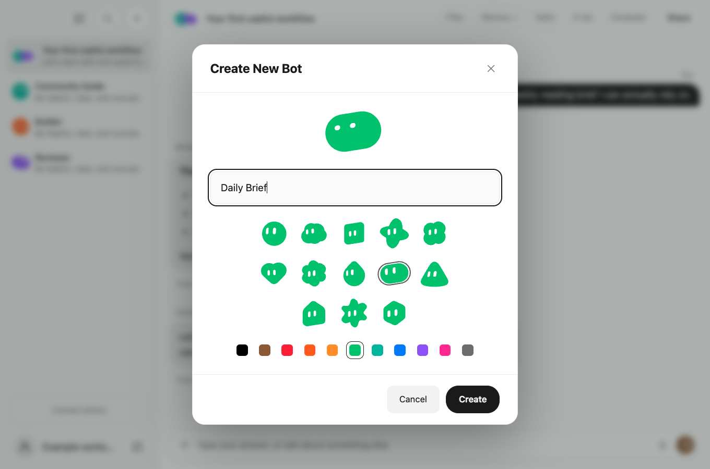

# Gratis

**Build one useful assistant workflow. Then make it repeatable.**

This private community edition builds on [Gratis Core](https://github.com/promptadvisers/gratis). It includes the shared desktop and mobile runtime, community exercises and a workspace for member features. There is one app and one workspace.


## Start here

```sh
git clone https://github.com/promptadvisers/gratis-community.git
cd gratis-community
npm ci
npm run setup:assets
npm start
```

You need repository access, macOS Apple Silicon, Node.js 22+ and npm. You can explore demo mode before connecting an eligible provider account. Provider limits and terms still apply. The app is called **Gratis**. Desktop and mobile use the existing Gratis workspace. Updating the app preserves your chats, credentials, memory and files.

## Continue on your phone

Open **Connect phone** in the desktop sidebar, scan its temporary QR code, then approve the phone on the desktop. The mobile companion remembers the connection and syncs your chats while Gratis is running and your Mac is awake. Choose Claude or Codex and a model from the phone’s chat menu; replies use the subscriptions signed in on your Mac. Add it to your iPhone Home Screen for a standalone view. A relay must be provisioned first; see the [mobile setup and privacy guide](docs/MOBILE.md).


## Optional team roles

| Bot | What it helps with |
| --- | --- |
| Community Guide | Turn a vague intention into one useful first task |
| Builder | Produce a practical workflow and verify its result |
| Reviewer | Find material gaps without repeating the whole answer |

These are optional role templates for community workflows. Existing profiles and custom bots are preserved. The first bot in a group coordinates; it does not automatically make every bot answer.

## Choose your path

- **I want a first win:** [Start here](docs/START_HERE.md).
- **I want a repeatable workflow:** [Hands-on workshop](docs/WORKSHOP.md).
- **I want prompts I can adapt:** [Workflow recipes](examples/workflow-recipes.md).
- **I want to understand the app:** [User guide](docs/USER_GUIDE.md) and [architecture](docs/ARCHITECTURE.md).
- **I want to build a community feature:** [Development rules](docs/BUILDING_COMMUNITY.md).



## What is different from the public core?

The underlying tools and runtime remain shared. This repository adds deeper exercises and community features to the same Gratis app, with a private development line. Future community features belong here first. Shared improvements move to the public core only after deliberate review.

This is not a hosted subscription, a preconnected set of private accounts or a promise of unlimited model use. Local schedules require the app running and the Mac awake. Integrations are optional and use your own accounts. See [Privacy](PRIVACY.md), [Security](SECURITY.md) and the [setup guide](docs/QUICKSTART.md).

## For maintainers

`origin` is the private community repository. `upstream` is the public core. A pre-push hook blocks publishing directly from this checkout to the public core. Do not remove it to move a private feature. Prepare a separately reviewed, sanitized change in the public checkout instead.

The source is available under the inherited MIT license. Repository access and software licensing are separate matters; do not assume a private GitHub repository itself creates a restriction on redistribution of MIT-licensed code.
