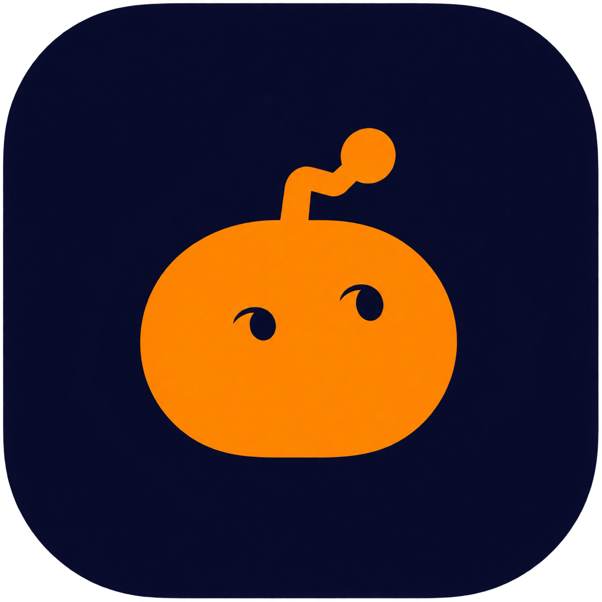
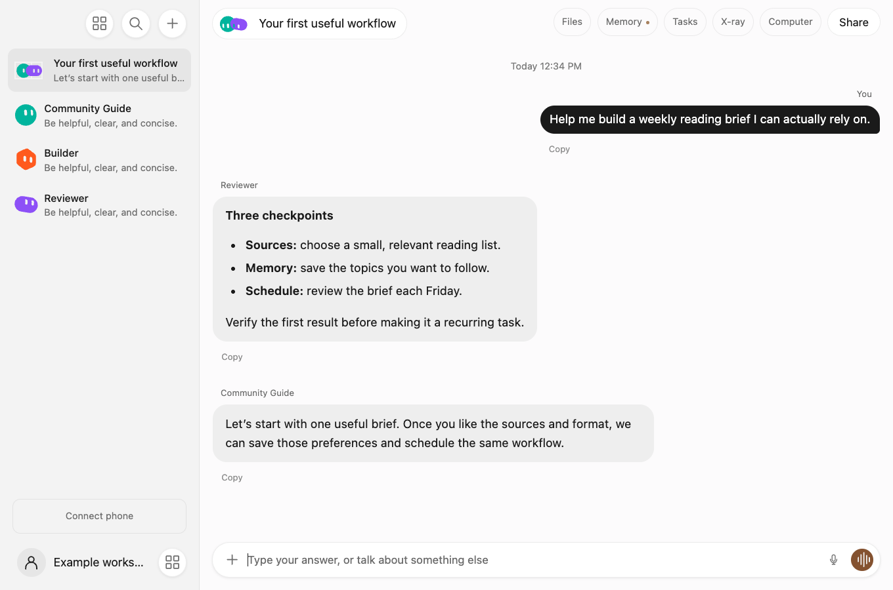
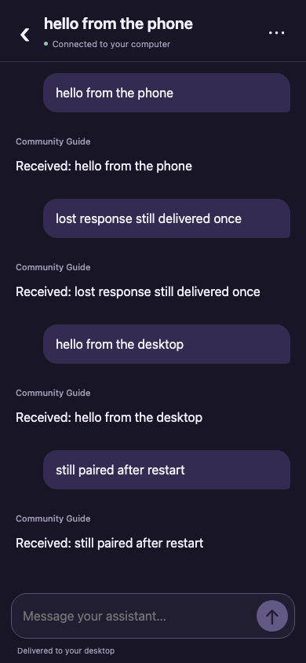

# Gratis

<p align="center"></p>

**Your assistants, conversations and useful context in one desktop app. Continue the same conversation on your phone.**

Gratis is a community-developed desktop app for focused assistants, group chats, local memory and scheduled work. Choose an eligible Claude or Codex account, give a bot a job, and connect additional tools when you need them. The app is called **Gratis** on every device. This repository contains the community development edition; the separately reviewed [public core](https://github.com/promptadvisers/gratis) is also available.

> **Current release: experimental preview.** Mac builds have ad-hoc integrity signatures but are not Developer ID signed or notarized. Windows builds are unsigned. Security warnings may remain. Review the source and [installation notes](docs/DOWNLOADS.md) before installing. No model subscription, cloud hosting, preconnected accounts or private user data is included.



## Interactive Pages

Ask your existing agent to create an interactive document, dashboard or visual explanation. Open its page card, request revisions in chat, and share selected pages through your team space. The same pages and agents are available on a paired phone. See [Pages: creation, editing and sharing](docs/PAGES.md).

## Optional sharing and team pilot

[Bot templates](docs/BOT_TEMPLATES.md) share reviewed configuration without private data. The [private team pilot](docs/TEAM_PILOT.md) adds nested client/project spaces, live shared human chats and optional AI replies using the sender's local provider. It is community-only, opt-in, and not intended for public hosting. See its documented limitations before enabling it.

## Reliability and recovery

Configure run limits, preserve partial work, and create verified local checkpoints in Settings. See [limits and recovery](docs/RELIABILITY.md) for the exact behavior, storage limits and restore commands.

## Choose your starting point

| What you want | Start here |
| --- | --- |
| Install the app without working on code | [Download and install](#download-and-install) |
| Ask Claude Code or Codex to set it up | [Copy the setup prompt](#let-claude-code-or-codex-help) |
| Run or develop from source | [Source setup](#run-from-source) |
| Get an actual AI response | [Connect your provider](#connect-claude-or-codex) |
| Use the same chats on your phone | [Phone pairing](#continue-on-your-phone) |
| Add a cloud browser or connected apps | [Optional capabilities](#optional-capabilities) |
| Fix an installation problem | [Troubleshooting](#troubleshooting) |

## Download and install

Open [GitHub Releases](https://github.com/earlyaidopters/gratis-community/releases) and select the latest preview. Expand **Assets** if the files are collapsed. Pick the file for your computer; the automatic GitHub **Source code** ZIP is source, not an app installer.

| Platform | File to choose | Install |
| --- | --- | --- |
| Apple silicon Mac (M-series) | `Gratis-VERSION-mac-arm64.dmg` | Open the DMG, drag Gratis into Applications, launch Gratis |
| Intel Mac | `Gratis-VERSION-mac-x64.dmg` | Open the DMG, drag Gratis into Applications, launch Gratis |
| Windows 10/11, x64 | `Gratis-VERSION-win-x64.exe` | Run the installer; choose your install folder if needed |
| Ubuntu 24.04, x64 | `Gratis-VERSION-linux-amd64.deb` | Run `sudo apt install ./Gratis-VERSION-linux-amd64.deb` with your downloaded filename |
| Linux x64, portable | `Gratis-VERSION-linux-x86_64.AppImage` | Make it executable and open it; FUSE 2 may be needed |

Windows ARM64 and Linux ARM64 installers are not currently supplied. On a Mac, **Apple menu → About This Mac** identifies the chip. Do not disable Gatekeeper, SmartScreen or antivirus globally. If you do not want an unsigned preview, wait for a signed release. More details and checksums are in [Downloads](docs/DOWNLOADS.md).

You do not need Node.js to run an installer. You do need the chosen provider's native client and an eligible account for live replies. Your AI subscription remains with its provider.

## Let Claude Code or Codex help

Use a local coding assistant that can access your terminal and files. A web chat without local tools cannot install an app on your machine. Paste this prompt into Claude Code or Codex:

```text
Help me install and verify Gratis from https://github.com/earlyaidopters/gratis-community.

Read the current README, docs/AGENT_SETUP.md, docs/DOWNLOADS.md and applicable AGENTS.md before making changes. Inspect my OS and CPU architecture. Prefer the matching GitHub release installer if I want to use the app; use source setup only if I want to develop it or no suitable installer exists.

Explain the unsigned-preview status. Do not disable operating-system security, bypass warnings, delete my data, replace unrelated apps or expose credentials. If Gratis already exists, preserve its identity and workspace and tell me before replacing its binary. Never copy another application's private data.

Install only the prerequisites this route needs. If installing from source, use a new directory, check Node.js 22+ and Git, then run npm ci and npm run setup:assets. Launch with npm start. Review the setup script before executing it.

Ask me which provider to use: Claude or Codex. Use the official native client and normal account sign-in. Let me complete login personally. Never ask me to paste a token or read auth files. Check the provider in Gratis Settings and verify one actual short response. Label demo output as demo.

Leave Composio, mobile relay, cloud computer, T3 and voice tools optional unless I ask for them. Do not buy or deploy services silently. Use the existing app name Gratis, not a separate Community app.

At the end report the version, install/source path, launch method, chosen provider, whether a live reply actually worked, and anything still missing. Do not claim success from a mock or from a process merely starting.
```

The [full assistant setup guide](docs/AGENT_SETUP.md) covers existing installations, Windows PATH, isolated source testing, and the acceptance checklist. Setup may require your interaction for account login, OS permissions or security prompts. A coding assistant cannot remove provider eligibility requirements.

## Run from source

Requirements: **Node.js 22 or newer**, npm, Git, a graphical desktop and an internet connection for dependencies. Use native Windows tooling for the native Windows app; a WSL-only provider login is not a native Windows login.

```sh
node --version
npm --version
git --version
git clone https://github.com/earlyaidopters/gratis-community.git
cd gratis-community
npm ci
npm run setup:assets
npm start
```

`npm ci` installs the versions in the lockfile. `setup:assets` downloads checksum-verified model assets and the supported Mac Composio client into this checkout; it does not sign you in. Review [scripts/setup-assets.mjs](scripts/setup-assets.mjs) before running it. Source mode is a development launch, not an installed app that starts by itself.

**Workspace distinction:** a source run uses this checkout's `data/` directory; a packaged app uses the operating system's Gratis data directory. Do not copy encrypted credential files between them. For an isolated source test, set `GRATIS_DATA_DIR` to a new private directory, as shown in [Agent setup](docs/AGENT_SETUP.md).

To build installers on their native platform:

```sh
npm run dist:mac -- --arm64
npm run dist:mac -- --x64
npm run dist:win
npm run dist:linux
```

Build only the target appropriate to your host. Cross-platform release builds use GitHub Actions. See [Downloads](docs/DOWNLOADS.md) for build checks and current unsigned status.

## Connect Claude or Codex

1. Install the provider's official native client on this computer: [Claude Code](https://code.claude.com/docs/en/setup) or [Codex](https://github.com/openai/codex).
2. Complete its normal sign-in yourself. Gratis uses the existing client login; do not paste subscription tokens into files or messages.
3. Open **Gratis → Settings → AI provider**. Select your provider and check/refresh the connection.
4. Choose a model available to that account. Claude offers Haiku, Sonnet and Opus; Codex lists the models available through its integration.
5. Send a small request such as “Give me three alternative titles for a note about planning my week.” Verify a live response. A message labeled **Demo** does not establish a working provider connection.

You can switch providers later. Account eligibility, usage limits, service availability and provider terms still apply. Gratis is not a free model subscription or a way to bypass limits. A Claude web login alone does not install Claude Code; a Codex web session alone does not install the native CLI.

## Your first useful workflow

1. Create one assistant with **+**, give it a name and avatar, and state its purpose in the first conversation. Review the generated instructions; edit them when needed.
2. Start with a result you can check: a draft, a summary of a file you supply, or a short plan. Web research needs the corresponding tools; check linked sources yourself.
3. Open **Memory** to inspect, correct or forget saved context. Memories can apply to your profile, one bot or one conversation. Keep credentials out of memories.
4. Add a second specialist only when helpful. In a group, the first bot coordinates and brings others in when needed. `@Name` addresses one bot; `@everyone` deliberately asks for multiple perspectives.
5. Once the task works manually, use **+ → Scheduled tasks** for a recurring version. Verify its timezone, next run and instructions. Use **Run now** to test it.

Closing the desktop window can leave schedules running; **quitting Gratis or sleeping the computer stops execution**. Missed runs are coalesced, not replayed as a backlog. Review failures before re-enabling a paused task. Details: [Quickstart](docs/QUICKSTART.md), [User guide](docs/USER_GUIDE.md), [Schedules](SCHEDULES.md), [Workflow recipes](examples/workflow-recipes.md).

## Continue on your phone

The phone is a companion to the same desktop workspace, not an independent hosted AI service. It shares your agents, avatars, chats and desktop provider connection.

1. Provision your own HTTPS mobile relay using [Mobile setup](docs/MOBILE.md), or use one supplied to you by a trusted operator. A public shared relay is not bundled.
2. Keep Gratis running and your computer awake. Open **Connect phone** and configure your relay.
3. Scan the temporary QR code on your phone and approve **Trust this phone** on desktop.
4. Open the link in Safari. Optionally use **Share → Add to Home Screen**; a separate browser storage profile may require pairing again.
5. Send a test message on the phone. Check it and the reply on desktop, then send one from desktop and check the phone. Confirm the same agent name and avatar on both.

The remembered connection survives normal reloads. Disconnecting the phone revokes it. Current phone transport encrypts messages, audio and screen snapshots between your desktop and phone. The QR fragment carries the key; upgrading an older pairing requires a fresh code. The relay still serves the phone application and sees routing metadata; see the trust boundary in [Mobile](docs/MOBILE.md#private-transport-and-trust-boundary). If the desktop is offline, the phone keeps your draft but cannot execute the request. See [Mobile](docs/MOBILE.md) for limits, credentials and disconnection.



## Optional capabilities

| Capability | What you need | Guide |
| --- | --- | --- |
| Connected apps | Your Composio account; authorize each service separately. Mac has bundled browser sign-in; Windows/Linux use a project API key in Advanced settings | [User guide](docs/USER_GUIDE.md#connected-apps) |
| Cloud computer | Your own supported backend, endpoint and scoped desktop token; hosting may cost money | [Cloud setup](docs/CLOUD.md) |
| Long-running project work | An available T3 environment and project permissions | [T3](T3.md) |
| Voice dictation | FFmpeg and Whisper installed on the desktop; optional Haiku text cleanup | [Voice setup](docs/QUICKSTART.md#optional-voice-input) |
| PDF text extraction | Poppler `pdftotext` on the desktop PATH | [Platform notes](docs/DOWNLOADS.md) |

The **Computer** panel does not create hosting on its own. After a backend is configured, it supports live viewing, resizing/expansion, **Take control**, and **Give control back**. Giving control back inspects the changed browser and resumes unfinished work. Returning Home closes the preview without deleting browser state. Saved Files and the chat result are the durable handoff; a spinning avatar alone is not evidence that a task completed.

Voice recording appears in the composer, with a recording indicator. Transcription is performed by local Whisper; Haiku can clean up text. It is not an always-on voice call, and Haiku is not the audio transcription engine.

## Updates, backups and removal

- Close/quit Gratis before replacing its binary. Install a newer release over the same application. Preserve app identity and the existing data directory.
- Back up the entire data directory before a major update. It may contain private chats, memory, files and encrypted settings; keep the backup private. Encryption tied to the OS keyring may not transfer to another computer.
- Packaged app data: macOS `~/Library/Application Support/Gratis/data`; Windows `%APPDATA%\Gratis\data`; Linux `$XDG_CONFIG_HOME/Gratis/data` or `~/.config/Gratis/data`.
- Source data: `data/` within the checkout unless `GRATIS_DATA_DIR` overrides it.
- Removing the app is separate from erasing your data. Windows uninstall retains user data. Delete a workspace only when you intentionally want to erase it and have a backup.
- Desktop and phone rely on the same workspace. This is not automatic desktop-to-desktop cloud backup.

## Troubleshooting

| Symptom | Check or next step |
| --- | --- |
| I downloaded source code and cannot open an app | Choose the `.dmg`, `.exe`, `.deb` or `.AppImage` under release Assets, or follow source setup |
| macOS or Windows warns about the publisher | Current previews are unsigned. Review the source and release, or wait for signing; do not disable system protections globally |
| `node`, `npm` or `git` is missing | Install official tooling for source setup, or use an installer instead |
| Provider not found | Install the native provider client, complete sign-in, restart Gratis and refresh its connection |
| Windows provider exists only in WSL | Install/sign in natively for the Windows build; WSL credentials are a separate environment |
| The reply is labeled Demo | Select the live provider in Settings; verify sign-in and a real response |
| Secure storage unavailable on Linux | Use an active graphical session and an unlocked Secret Service keyring such as GNOME Keyring; plaintext fallback is refused |
| Phone cannot connect | Check relay setup, desktop awake/running status and internet; regenerate an expired invitation. Clearing site data removes pairing |
| Computer pane is empty | Configure/test the cloud backend, then start or retry the computer. A relay for mobile is not a cloud browser |
| Microphone records but transcription fails | Check desktop FFmpeg/Whisper, model download, microphone permission and PATH |
| A scheduled task does not run | Check enabled status, timezone, next run, paused errors, and whether Gratis and the computer stayed awake |
| PDF produces no text | Install Poppler; scanned PDFs may require OCR outside the current extraction path |

When reporting a bug, include the app version, OS/architecture, provider name, steps and a synthetic example. Remove private text, account identifiers and tokens from logs/screenshots. See [Security](SECURITY.md) for sensitive reports.

## License and further reading

The project's own source uses the standard [MIT license](LICENSE): use, modify and redistribute it, including commercially, while retaining the required copyright and permission notice. Dependencies retain their own licenses; see [Third-party notices](THIRD_PARTY_NOTICES.md). There is no extra noncommercial clause or membership requirement in the source license. Provider services have separate terms.

Gratis is independent and is not endorsed by the creators of GrokBot or by the model providers. A source-code license is not permission to use someone else's trademarks, proprietary assets or private data.

- [Hands-on workshop](docs/WORKSHOP.md)
- [Architecture](docs/ARCHITECTURE.md)
- [Developing community features](docs/BUILDING_COMMUNITY.md)
- [Privacy](PRIVACY.md) and [Security](SECURITY.md)
- [Separately reviewed public core](https://github.com/promptadvisers/gratis)
