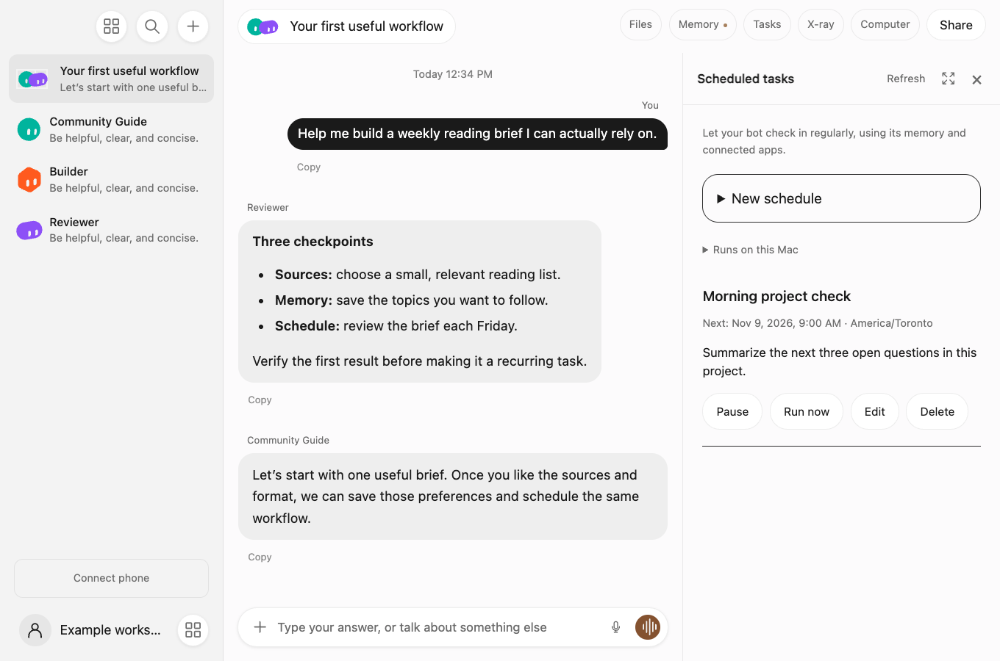

# Your first useful workflow

The goal is a result you would use again, not a large team of bots talking to one another.

## 1. Connect one provider

Follow the [setup guide](QUICKSTART.md). Choose an eligible Claude or Codex account. Keep optional integrations disconnected until your task needs them.

## 2. Give your assistant a clear role

Use Gratis or create a bot with a guide role. Try: “Help me create a weekly reading brief about a topic I follow. Ask only what you need to know first.” Choose a narrow topic and a short output format.

## 3. Produce a small first result

Ask for one brief with a few sources. Read the source links and check that the summary matches them. For a writing task, compare the final draft with your own intent.

## 4. Bring in a reviewer when useful

Create a group with your guide and optional Builder and Reviewer bots. Ask for an independent check of a specific claim or workflow. You can address `@Reviewer` directly. An ordinary greeting should not wake the whole team.

## 5. Save a preference, then make it recurring

Tell the bot an enduring preference explicitly, such as the topics or reading depth you want. Inspect the saved entry in Memory. After the first result is useful, open Scheduled tasks and choose a time and timezone.

Keep the Mac awake and Gratis running. The task can wait for you if an external action needs approval. Do not schedule an untested workflow and assume the timer makes it reliable.
